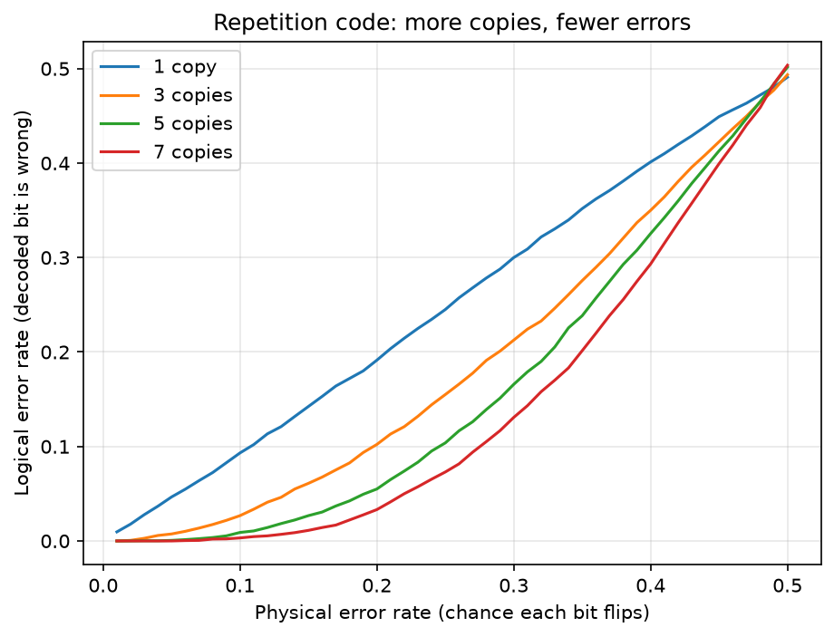

# Repetition Code Simulator

A Python simulation of the bit-flip repetition code, the simplest error-correcting code. It shows how sending a bit several times and decoding by majority vote makes errors rarer.

**Note:** this is a classical toy model, not full quantum error correction. Real quantum error correction has to protect quantum states without measuring them directly, which this simulation does not do.

## How it works
1. **Encode:** repeat one bit n times.
2. **Noise:** flip each copy independently with probability p.
3. **Decode:** majority vote.
4. **Measure:** how often the decoded bit is wrong, over many random trials.

## Result
At a 10% flip rate, one copy gives a logical error rate of about 0.0996. Three copies give about 0.0285, close to the exact value of 2.8% (the chance that two or more of three copies flip).



More copies reduce errors whenever the flip rate is below 50%. At 50% the bit carries no information and every line meets.

## Run it
```
pip install -r requirements.txt
python plot_results.py
python -m pytest
```

## Files
- `repetition_code.py`: encode, noise, decode, simulation
- `plot_results.py`: generates `results.png`
- `test_repetition_code.py`: automated tests

## Built with
Python, matplotlib, pytest. Built with AI assistance, with the logic checked by hand and by tests.